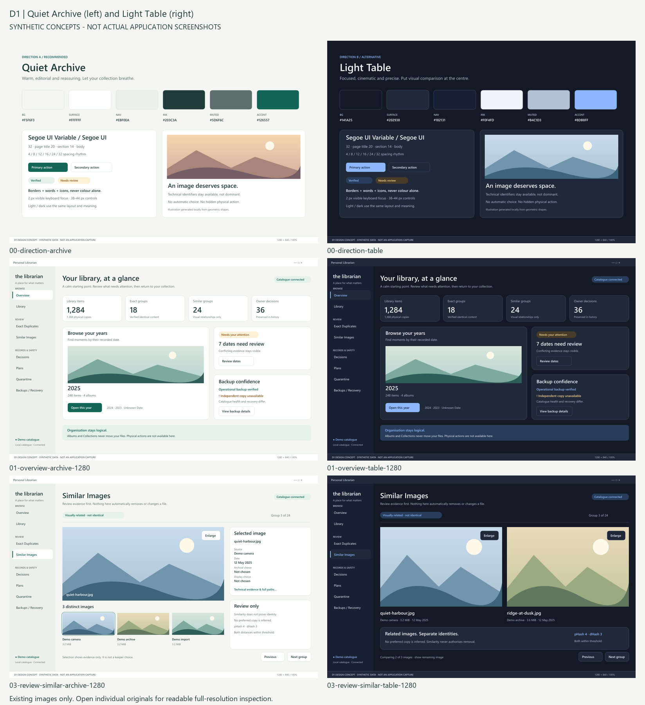
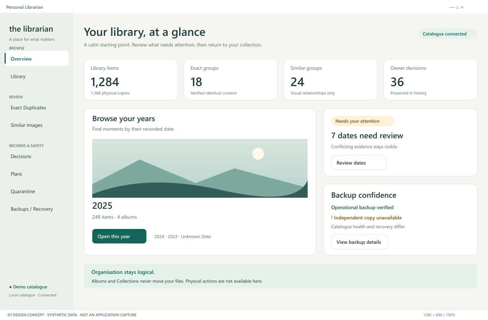
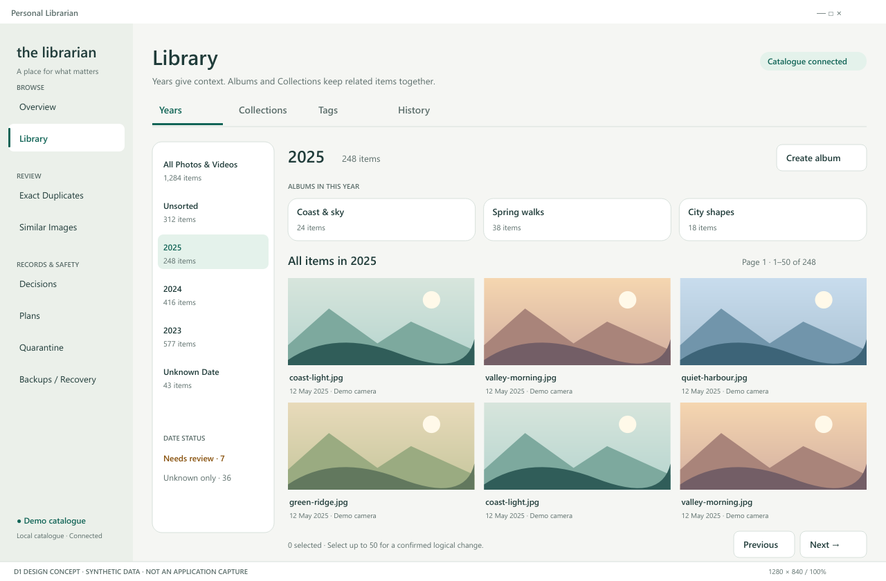
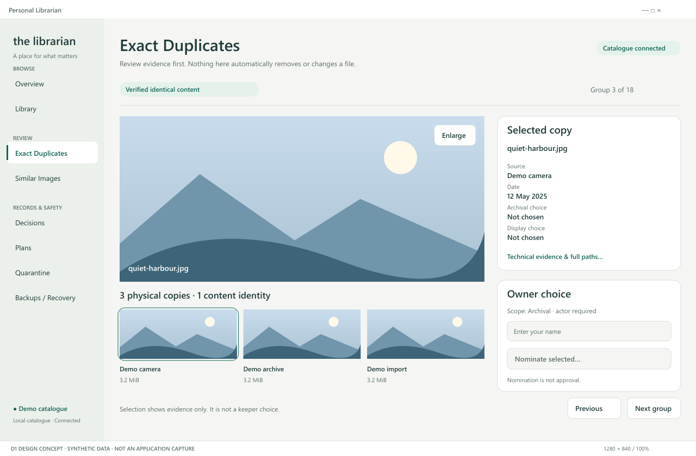
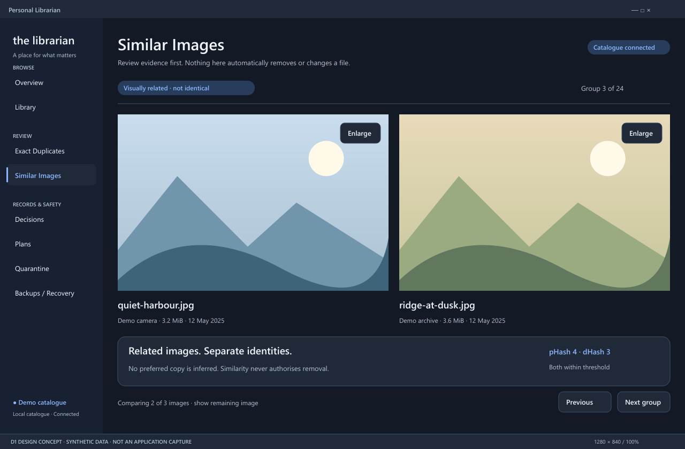
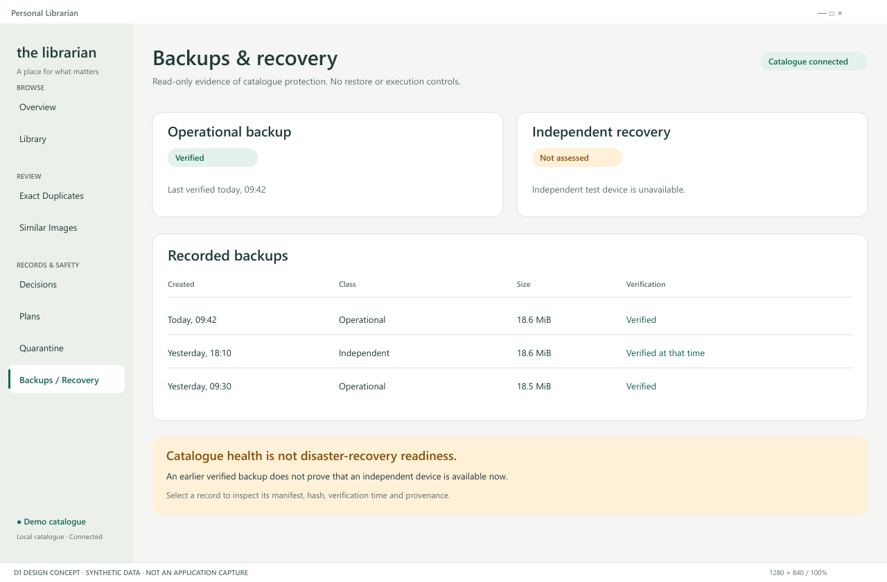

# D1 visual review — acceptance pending

Related to [issue #21](https://github.com/dreamingfree09/personal-librarian/issues/21).
Source anchor: `ad26c9b3c2d8d33188b1e97b4bbb38c368100bef`;
source tree: `a3cb664fbb32d2c2894fb0ad7ce4b33716ae08e9`.

**Every image is a synthetic design concept, NOT an actual application screenshot.**
All scene illustrations, filenames, counts, dates and catalogue-like values are fictional.
No owner media, private paths, real catalogue contents or credentials are included.
This draft publishes existing design evidence only; owner/Aether visual acceptance remains pending.
Quiet Archive is the recommendation, not an approved implementation direction.

## Start with the comparison

The contact sheet places Quiet Archive on the left and Light Table on the right:
direction board, Overview, and Similar review. It only resizes and arranges six
retained original PNGs. No screen was redesigned or regenerated.

## Readable original concepts

Open each PNG at full resolution. All 16 original PNGs and their 16 SVG masters
are retained unchanged in this bundle, including 1040px and 1920px variants.

| Screen | Existing visual evidence |
|---|---|
| Direction boards | [Quiet Archive](mockups/00-direction-archive.png) · [Light Table](mockups/00-direction-table.png) |
| Overview | [Quiet Archive](mockups/01-overview-archive-1280.png) · [Light Table](mockups/01-overview-table-1280.png) · [1920px](mockups/01-overview-archive-1920.png) |
| Library | [Years / Albums](mockups/02-library-years-1280.png) · [Selected Album](mockups/02-library-album-1280.png) · [Collections](mockups/02-library-collections-1280.png) |
| Narrow layout | [Library 1040px](mockups/02-library-years-1040.png) · [Overview 1040px](mockups/01-overview-archive-1040.png) |
| Exact review | [Copy inspection and explicit owner choice](mockups/03-review-exact-archive-1280.png) |
| Similar review | [Quiet Archive](mockups/03-review-similar-archive-1280.png) · [Light Table two-up](mockups/03-review-similar-table-1280.png) |
| Backups / Recovery | [Separate health and recovery readiness](mockups/04-backups-1280.png) |
| State coverage | [Loading, empty, unavailable, conflict, Unknown and focus](mockups/05-component-states.png) |

### Overview — synthetic concept, not an application screenshot

### Library — synthetic concept, not an application screenshot

### Exact review — synthetic concept, not an application screenshot

### Similar review — synthetic concept, not an application screenshot

### Backups / Recovery — synthetic concept, not an application screenshot

## Original report and measurements

- [Original D1 report](PERSONAL_LIBRARIAN_D1_DESIGN_SYSTEM_AND_VISUAL_PROTOTYPES.md): unchanged, including feature/source mapping, keyboard/state coverage and staged Qt plan.
- [Design tokens](design-tokens.json): extracted existing values; not application configuration.
- [Original layout checks](layout-checks.json): 16 valid rendered concepts, zero recorded off-canvas text or elisions.
- [Original contrast checks](contrast-checks.json): 17/17 measured pairs meet their recorded target; this is not implemented accessibility certification.
- [Original source evidence](source-evidence.json): repository-relative source paths, SHA-256 and reviewed revision.
- [Original self-contained gallery](index.html): download this directory to browse locally; GitHub displays HTML source. The historical footer says “Private design review”; this authorised, sanitised publication changes its availability, not its artwork.
- [Publication provenance](publication-provenance.json): original versus montage/token/index artifacts and SHA-256 identities.
- [SHA-256 index](SHA256SUMS.json): all bundle files except this checksum index itself.

The original full private gallery and historical evidence remain preserved. Original
generators and local machine/evidence paths are intentionally not published.
The report's **D1 delivery PASS** is not visual acceptance, runtime validation,
screen-reader certification or implementation approval.

## Decision boundary

Aether and the owner should inspect the boards, representative screens, density,
terminology, selection/focus, unavailable/conflict states and narrow layout before
choosing the direction or implementation scope. No application-wide redesign is
authorised by this draft. Python/Qt, backend contracts, data-safety guarantees,
branch protections and production data are unchanged.

[C2 / issue #20](https://github.com/dreamingfree09/personal-librarian/issues/20)
remains blocked by desktop-control infrastructure; no failed host approach was
retried for this publication. Issue #9 and the Qt 6.12 shutdown investigation remain
unresolved. No merge, release or application installation is included.
