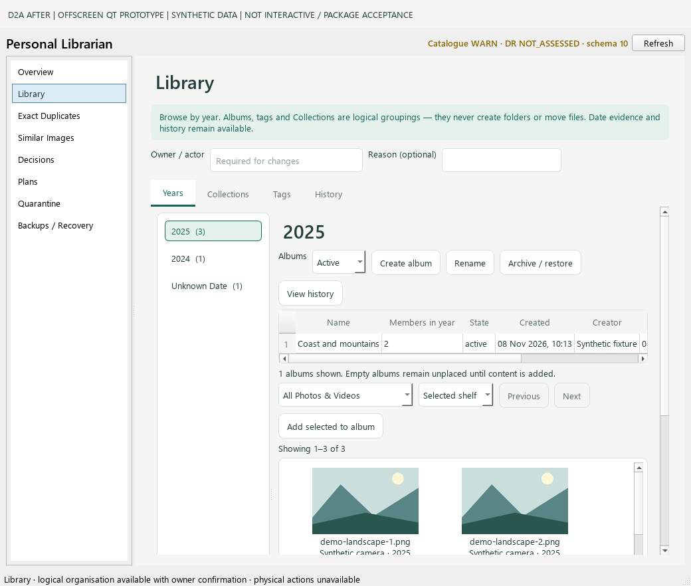
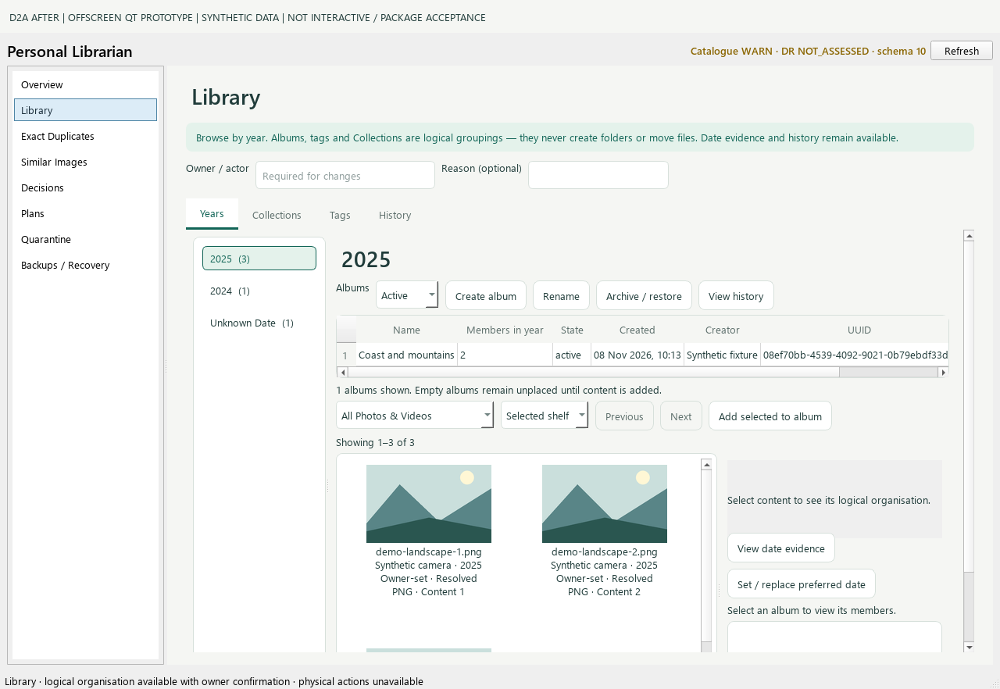
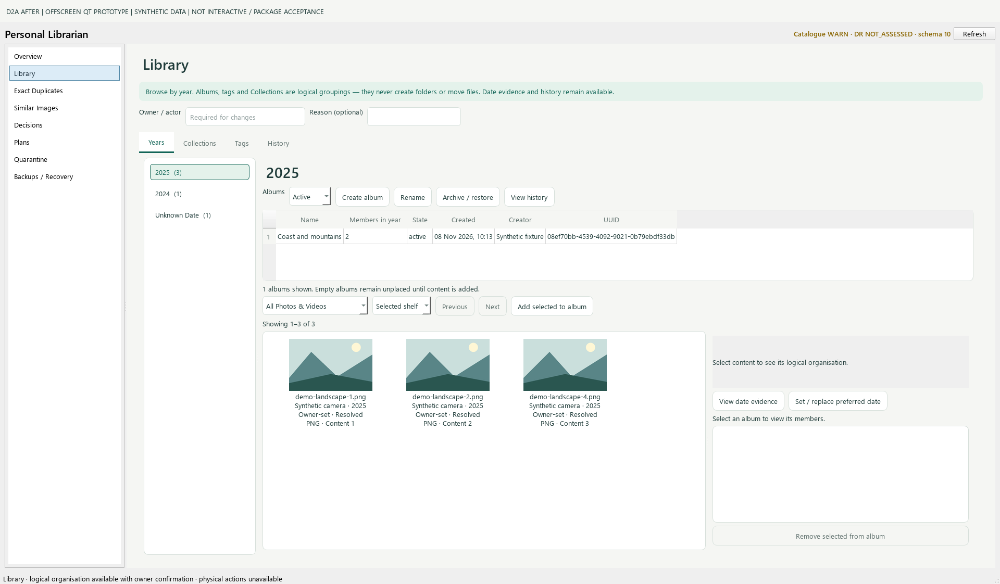

# D2A-V01 — readable Albums table viewport

Corrective response to [Aether review 5816885933](https://github.com/dreamingfree09/personal-librarian/pull/24#pullrequestreview-5816885933). **Draft; independent technical and owner visual acceptance required. No merge/release.**

Reviewed HEAD: `1760362ca7d6276ab8f2bb35c223ddffd7541062`, tree `2ee81f71c5723246609e1ff96128ce365944451e`.
Protected main: `ad26c9b3c2d8d33188b1e97b4bbb38c368100bef`, tree `a3cb664fbb32d2c2894fb0ad7ce4b33716ae08e9`.
Corrected application/capture source: `12fac6f2e2ade0e36f6cf2497cb39210df623d7c`.
Final PR HEAD/tree/test-merge and hosted results are recorded in the exact-revision PR handover.

## Minimal correction

`LibraryPage._build_years_tab` now reserves the polished Qt table frame, header,
one default data row and the horizontal scrollbar. Scrollbar space is reserved
even when absent, avoiding height oscillation during width changes. The existing
190px maximum remains; the outer Years page can grow and scroll vertically.
The content splitter's 350/560px minimums and selected-evidence container remain
unchanged. The sole runtime diff is nine presentation-only lines.

No service/SQL/catalogue/schema, logical selection or owner-authority handlers,
workers, security, dependencies, branch protection or release tooling changed.

## Reproduced failure and regression

A new real MainWindow/LibraryPage test creates an Album and membership in a
disposable synthetic catalogue. Before the correction, the first visual row was
29px high inside a 20px viewport at **both 1040×840 and 1280×840**. The 1920×1080
case already passed. The failing runs are retained privately.

The same test now verifies the whole first-cell rectangle is inside the actual
table viewport, the row can be clicked and resolves the same Album UUID, the
horizontal scrollbar does not overlap it, and the Year remains selected. At
constrained sizes it verifies outer vertical scrolling. The content splitter and
selected-evidence minimums are retained and the evidence region is reachable.
A separate empty-Album test checks the header, empty selection and disabled
logical removal. Existing Year navigation, Collections independence, date,
stale-selection, owner-confirmation and 50-item boundary tests remain unchanged.

## New labelled actual Qt captures

All images are **OFFSCREEN QT PROTOTYPES / SYNTHETIC DATA**. They are not native
interactive or package acceptance. The 42px banner is outside the measured window.
Existing [D2A images and report](../d2a/README.md) remain byte-for-byte unchanged.

| Actual window | Table height | Header | Data viewport | First visual row | Horizontal scrollbar |
|---|---:|---:|---:|---:|---|
| 1040×840 | 81px | 35px | 30px | 29px, fully contained | 14px, visible below row |
| 1280×840 | 81px | 35px | 30px | 29px, fully contained | 14px, visible below row |
| 1920×1080 | 137px | 35px | 100px | 29px, fully contained | absent |

[Selected-content evidence at 1280px](captures/after-selected-content-1280.png).
[Capture metadata and row rectangles](capture-manifest.json).
[Local validation record](local-validation.json). [SHA-256 index](SHA256SUMS.json).

The capture helper now rejects any after-capture whose first Album cell is not
fully contained. Its existing complete-preview and unchanged-catalogue checks
also passed. Fixture names, media and UUIDs are synthetic. No owner media or
production catalogue was accessed.

## Validation and retained limitations

- Focused desktop suite: **90 tests PASS**, zero failures/errors/skips, child and observer exit 0.
- Full local Windows suite: **388 tests, two errors, four existing environment skips**, child and observer exit 1. The same two synthetic-symlink creation errors are WinError 1314. No privileges, tests, skip rules or environment dependencies were changed to manufacture a pass. Original D2A failed evidence and this separate V01 run are preserved.
- Compilation, CRLF whitespace, exact-change-boundary and privacy checks passed. Hosted standard Windows CI and both qualified Python 3.13.16/3.13.17 lifecycle outcomes must be read at the new exact revision in the PR handover.
- Native 125%/150% scaling and interactive package acceptance remain **UNVERIFIED**. C2, issue #9, diagnostic PR #10 / Qt 6.12 and G3/G4 remain unchanged.

A supplementary narrow-layout probe found that the bottom logical Remove button
extends to y=545 in a 527px outer viewport after selecting an Album at 1040px.
Replaying the exact reviewed `_build_years_tab` and the corrected method produces
the **same** geometry. This pre-existing 19px clipping is recorded for Aether;
it is not the V01 Albums-row failure and no additional runtime change was made.
The supplementary failed assertion is retained privately, not presented as a pass.
The committed V01 regression targets the required Album row and selected-evidence
reachability; it does not claim every bottom control is fully visible.

Stop for independent corrective review and owner visual acceptance. No D2B.
