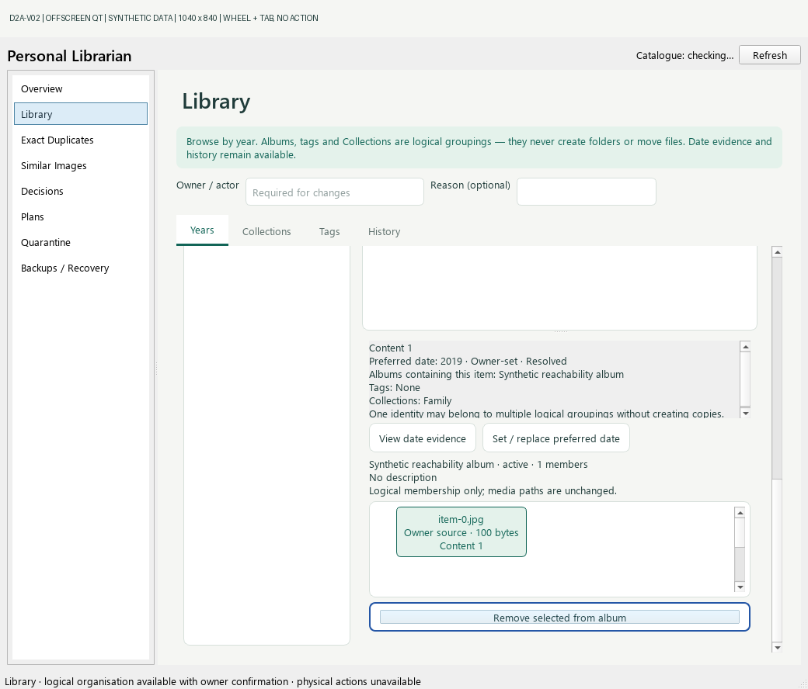
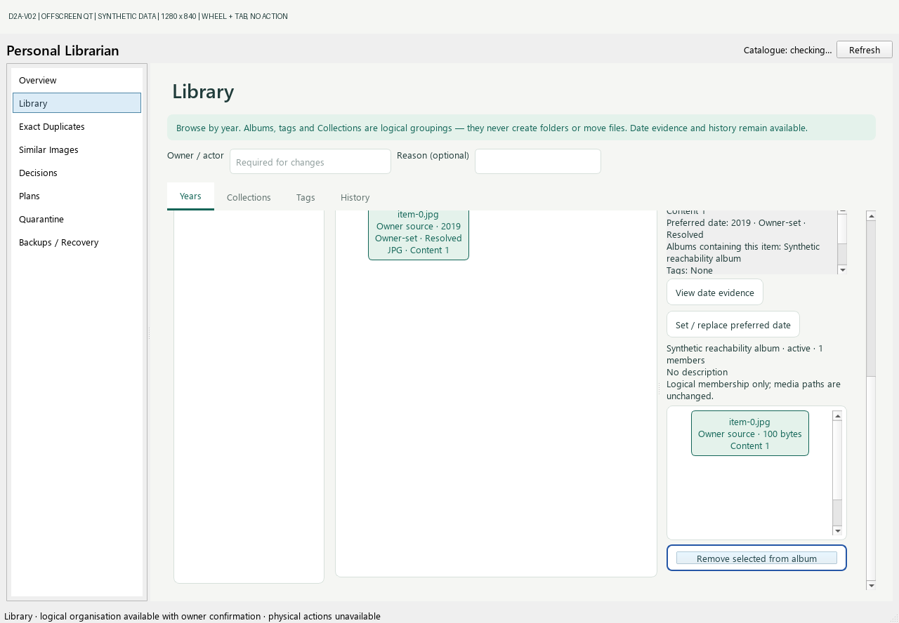
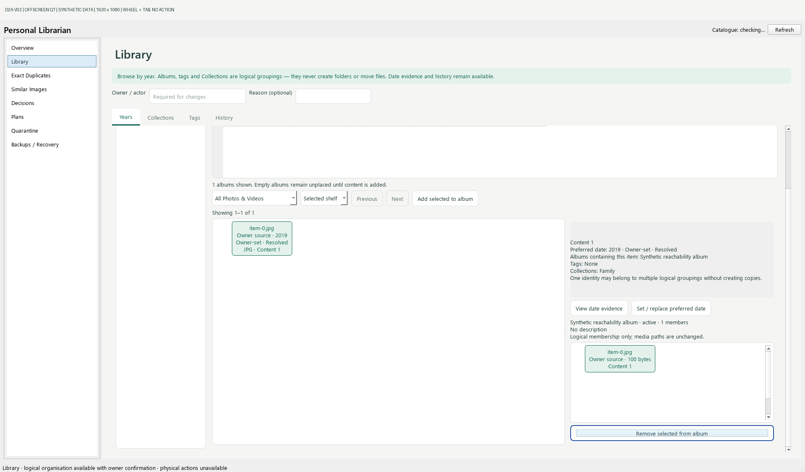

# D2A-V02: final control reachability

All images here are **actual offscreen Qt widgets over disposable synthetic data**. They are not interactive desktop or packaged-application acceptance. No owner data or source media was used. Synthetic missing-preview cards are intentional.

## Finding and correction

Accepted combined parent: `1f046803ad670b5315395734cb2888ae6274e45a` (tree `8e58f4256aa77ef2b50f9990c6052a48ec245644`). Protected main remains `d5962dddef399960a5579b5c30d001b17d207eac`.

The outer Years splitter did not propagate the right column's height-for-width requirement. At 1040 x 840 with the application font, the right column was 846 pixels high while its content splitter extended to y=929. The outer scroll range ended at 340. The Remove button remained at `[201,551,538,38]` in a 766 x 524 viewport after End and wheel scrolling. Direct focus was never accepted as proof of access. An additional ordinary forward-Tab probe from the owner field remained in the Albums table's cell-navigation cycle; it did not establish access to Remove.

The bounded correction uses the existing horizontal layout directly for the Year list and right column, instead of the outer splitter. Qt can now propagate wrapped heights to the existing outer scroll area. The content/detail splitter is unchanged. There is no extra nested scroll area, fixed-height inflation, target-focus override or action-handler change. The Year rail retains its existing 170–215 pixel bounds but no longer has its own splitter handle. Scroll-first presentation remains intentional, including at larger sizes when the complete content requires it.

The V01 Albums minimum-height reservation is unchanged byte for byte. Backend, SQL, worker lifecycle, dependencies, logical IDs, confirmation, Collections and navigation handlers are unchanged.

## User input and measured result

The fixture has one active Album and one member. Repeated ordinary wheel notches over the outer scrollbar reach its end. A mouse click selects the visible synthetic member. One upward wheel notch partially hides Remove without changing keyboard focus. A **real Tab key from the member list** then reveals the complete button and focuses it. No `setFocus`, `ensureWidgetVisible`, scrollbar `setValue`, Return, Space or button click is used for that acceptance sequence.

| Window | Outer viewport | End scroll value / max | Complete Remove rectangle after wheel and Tab | Wheel notches |
|---|---|---|---|---|
| 1040 x 840 | 766 x 524 | 714 / 714 | 248,459,491,38 | 12 |
| 1280 x 840 | 995 x 541 | 413 / 413 | 711,476,257,38 | 7 |
| 1920 x 1080 | 1606 x 781 | 173 / 173 | 1093,716,486,38 | 3 |

Before Tab, each button's bottom lies outside the viewport; after Tab the whole rectangle and visible region fit. Outer scrollbar overlap is excluded. The first Album row remains complete, member/content cards remain independently scrollable, and selected-content evidence remains available in its existing scroll panel. Controls at different vertical positions need not be visible simultaneously.

See [geometry.json](geometry.json) for exact rectangles, including actual scrollbar coordinates, selected detail, and unchanged synthetic database proof. The capture records the accepted parent HEAD plus the modified source file SHA-256; it was generated before the correction commit. Final candidate identities and hosted validation are recorded in the PR handover.

## Regression and safety evidence

- New real-widget regression exercises 1040 x 840, 1280 x 840 and 1920 x 1080, wheel access, normal member-to-Remove Tab traversal, scrollbar exclusion, stable Album/member identity, empty actor, zero activation and unchanged synthetic catalogue bytes.
- The final regression fails at 1040 on the exact accepted original `LibraryPage` bound into `MainWindow`, and passes with the layout correction. An initial dynamic-load probe accidentally retained the current MainWindow class binding; its misleading pass was retained privately and not used as acceptance evidence.
- All **91 focused desktop tests pass**, including populated/empty Albums, Year navigation, Collections independence, selected evidence, bounded selection and explicit confirmation.
- Native local complete suite: **389 tests, 2 errors, 4 skips**, child/observer exit **1**. Both errors are the preserved Windows symlink privilege (`WinError 1314`) limitation. No privilege, test or dependency suppression was introduced. Local Python 3.13.1 / Pillow 12.3.0 is not the qualified hosted runtime.
- Compilation and CRLF-aware whitespace validation pass. Fresh standard Windows CI and both qualified lifecycle versions must complete on the final published revision; consult the PR handover for actual process exits and revision binding.
- All captures: **zero Remove activations, zero logical mutations, unchanged synthetic catalogue SHA-256**. Original capture sets, failed probes and historical evidence remain untouched.

Reproduce the focused test with `python -X faulthandler -u -m unittest tests.test_desktop_quiet_archive -v`. Create new evidence with `python -X faulthandler -u tools/capture_d2a_reachability.py --output tmp/new-reachability-evidence` (create-only).

## Visual evidence

### 1040 x 840

### 1280 x 840

### 1920 x 1080

## Review boundary

PR #24 remains draft and unmerged. Owner prototype/design approval is already recorded. This correction requires Aether's exact-revision review, not another design approval. No D2B, package installation, release, production operation or media access is included. Existing issue #9 and the separate Qt shutdown investigation remain open.
