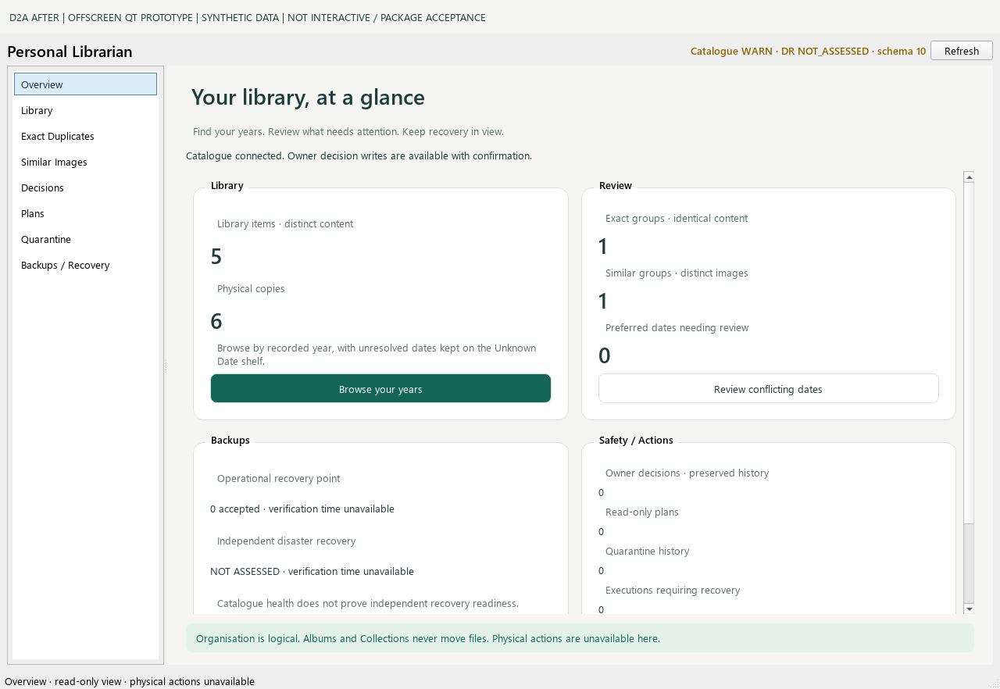
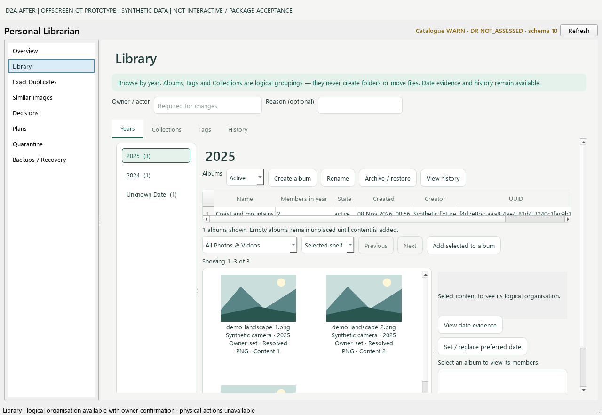
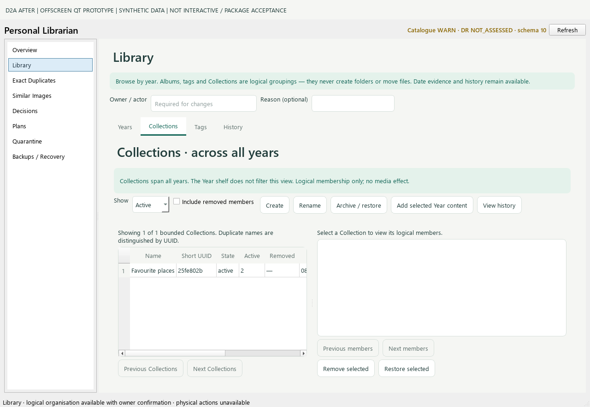

# D2A — Quiet Archive Overview / Library prototype

**Technical and visual review required. No merge or release.** Related to [issue #23](https://github.com/dreamingfree09/personal-librarian/issues/23).

Initial implementation: `6cfc86dd8bf6e9e2f181460b640c391875f7ca9b`.
Selected-detail correction: `2fcfa2d7d26b1af79be3637955b22878cacab012`.
Final captured source: `f09346e3f909f841303c2b2b2ce41c7d4e6e0e33`.
Protected base: `ad26c9b3c2d8d33188b1e97b4bbb38c368100bef`, tree `a3cb664fbb32d2c2894fb0ad7ce4b33716ae08e9`.
Approved D1 reference: [PR #22, c61f213](https://github.com/dreamingfree09/personal-librarian/pull/22), tree `fda9ff258d3d04453822fe7ca741c8d86687b79b`. Original D1 artwork is unchanged.

## What changed

- `quiet_archive.py`: page-scoped palette, typography, cards, controls, focus styling and a wrapping control layout. No application-global stylesheet or dependencies.
- `main_window.py`: real service-bound Overview cards distinguish content identities/copies, exact/similar groups, conflicting preferred dates, owner history, operational and independent recovery. Existing catalogue technical details are expandable. Cards route through the existing navigation and Library date filter.
- `library_page.py`: four original tabs, Year shelf, logical Albums, Collections, Tags and History retain their widgets, IDs, handlers and bounded queries. Toolbars wrap; narrow layouts stack the content/detail panes with vertical scrolling. Collections has no visible Year shelf and explicitly says it spans all years. Returning to Years retains its selection.
- `test_desktop_quiet_archive.py`: 13 focused regressions added for counts/readiness, unavailable/loading state, stale callbacks, real worker delivery, event-loop responsiveness, schema-9 fallback, Years versus Collections, date filters/precision, focus/accessibility labels, long plain-text evidence, horizontal reachability, no selection, canonical routing and actual main-window dimensions.
- `capture_d2a_prototype.py`: create-only, worktree-local disposable synthetic catalogue/images; actual widgets rendered offscreen, with a permanent evidence label and catalogue byte-preservation check.

## Before and after — actual widgets, offscreen only

**Every image below is an OFFSCREEN QT PROTOTYPE rendering with synthetic data. It is not an interactive desktop screenshot or packaged application acceptance.** The geometric images are newly generated disposable fixture media, not D1 artwork or owner media. Names, IDs, dates and catalogue values belong solely to that fixture.

### Overview

[Accepted baseline, before](captures/before-overview-1280.png)

### Year-first Library

[Accepted baseline, before](captures/before-library-years-1280.png)

### Collections — no implied Year filter

| View | Additional evidence |
|---|---|
| Overview | [1040px](captures/after-overview-1040.png) · [1920px](captures/after-overview-1920.png) |
| Library | [1040px](captures/after-library-years-1040.png) · [1920px](captures/after-library-years-1920.png) |
| Selected content | [Explicit selection and evidence](captures/after-selected-content-1280.png) |

The requested application viewports are 1040×840, 1280×840 and 1920×1080.
The PNGs add a separate 42px evidence banner above the actual window. The final
capture helper asserts the actual window dimensions; the banner does not stand in
for a viewport measurement. Vertical scrolling is deliberate at constrained sizes;
tables retain horizontal scrolling for full technical columns.

## Preserved contracts and mapping to D1

| D1 intent | D2A mapping / boundary |
|---|---|
| Quiet Archive palette, spacious cards, clear headings | Scoped presentation layer on Overview and Library; existing main shell and other pages remain familiar. |
| Year as bookshelf; Album as logical grouping | Existing Year and Album selection/query/UUID contracts retained, including 1–9999 and Unknown Date. |
| Collections cross years | Separate tab, explicit neutral context, no visible highlighted Year shelf. No Collection contains Albums. |
| Needs Review distinct from Unknown-only | Existing filter/service calls unchanged; separate regression verifies membership and year-only precision. |
| Technical detail secondary | Overview details expandable; Library evidence, full table columns and existing history remain accessible. |
| Explicit owner authority | Actor/reason fields, confirmations, 50-item mutation cap, nomination versus approval and physical-action exclusions retained. |
| Stable asynchronous identity | Original Worker/AsyncPage/Library worker and Review classes unchanged; existing stale-selection tests retained. New Overview request generation rejects obsolete success/error deliveries through a bound QObject receiver. |
| Main routing | Same QListWidget, QStackedWidget, eight indexes and saved section identities. Only Overview/Library ignore hidden pages' minimum-size hints; legacy pages keep normal sizing when active. |
| No backend redesign | No changes to services, SQL contracts, catalogue/migrations, physical actions, security, packaging/versioning, dependencies or workflows. |

Light Table comparison is not implemented here. Its optional future D2B work must
remove Exact-only archival/display fields from Similar concepts and keep all group
members accessible. This prototype makes no decision for D2B.

## Validation and limits

[Local validation record](local-validation.json), [after capture manifest](after-capture-manifest.json), [before capture manifest](before-capture-manifest.json), [SHA-256 index](SHA256SUMS.json).

- Final focused desktop run: **88 tests, zero failures/errors/skips, process and observer exit 0**.
- Full local Windows attempt: **386 tests, 2 environment errors, 4 skips, child/observer exit 1**. Both errors occurred creating synthetic symlinks (`WinError 1314`). The host has Python 3.13.1 / Pillow 12.3.0; it is not the pinned hosted qualification environment. Evidence is retained; no failure converted to a skip or success and no host policy/dependency changed. The original 385-test attempt is also retained. The corrected source was tested again because of the demonstrated clipping defect, not to obtain a green rerun.
- Complete hosted Windows CI and both qualified Python 3.13.16/3.13.17 lifecycle checks must be read at the exact draft PR revision. Their actual process exits and results are recorded in the PR handover; local failure is not erased by hosted success.
- Source compilation and CRLF-aware whitespace checks passed. Original worker/review class ASTs compare unchanged.
- Final offscreen captures exited 0; synthetic catalogue SHA-256 was unchanged before/after navigation, rendering and close.
- Layout checks exercise actual widget sizes and control-row horizontal reachability. Focus tests exercise Tab navigation and Qt accessibility names. A blocked synthetic read leaves the UI timer/event loop responsive. There is no animation or whole-library preload.
- **Native Windows 125%/150% display scaling, screen-reader experience and interactive packaged behaviour remain UNVERIFIED.** Offscreen font registration uses installed Windows fonts in the capture process only; it does not modify runtime configuration.

First capture failures and corrections remain in private evidence: an incorrect
fixture API argument; offscreen font discovery rendering boxes; hidden-page sizing;
and a new transient Overview callback that failed to deliver. Corrections were
limited to the helper/presentation layer, with real-worker and real-shell tests
added. A final visual check also demonstrated clipped long selected-item text; the existing label now sits in a scrollable container, and the focused test verifies its complete height and reachable scroll range. One subsequent fixture capture lacked previews because of a long private cache path on this host; it was retained but not published. The final capture uses a shorter disposable path and now asserts every expected preview is present. No previous failed output was overwritten or presented as final evidence.

## Remaining visual review points

This is a working presentation prototype, not a pixel-for-pixel D1 implementation.
Existing Album tables and content grids are retained to preserve tested selection
semantics. At 1040px, secondary controls/details use vertical scrolling. The main
shell, Exact/Similar pages and other pages are not restyled. Owner/Aether should
review density, scrolling, evidence reachability and visual hierarchy before any
broader redesign. No claim of full accessibility certification is made.

C2 / issue #20 remains blocked, with no repeat of the failed controller approach.
Issue #9, diagnostic PR #10, Qt 6.12 shutdown and G3/G4 availability remain unresolved.
No production catalogue, owner media, installation, release, merge or D2B work occurred.
Stop for independent technical and visual review.
